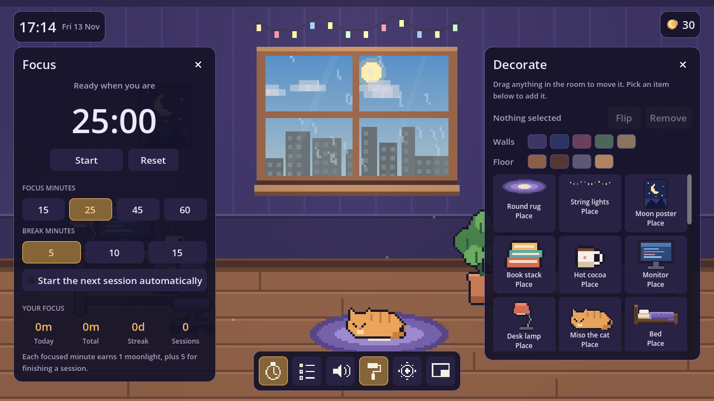

# Midnighty Room

A cozy late-night room that sits on your desktop while you work. Decorate it, mix your own lofi soundscape, run a focus timer, tick off tasks, and earn moonlight to unlock more furniture.

Built with Godot 4.7 (GDScript, Compatibility renderer). Target: Steam on Windows first; the same project exports to Linux, macOS, Android and iOS.




## Run it

1. Install [Godot 4.7.x](https://godotengine.org/download) (standard build, not .NET).
2. Open Godot, choose **Import**, and pick `project.godot` in this folder.
3. Press **F5**.

A ready-made Windows build is in `build/windows/MidnightyRoom.exe` if you were given the project folder rather than a fresh clone (builds are not stored in git).

## What is in the game

| Feature | Notes |
|---|---|
| Room | 320x180 pixel art scaled 4x. 32 placeable items across wall, rug, floor and tabletop layers. 5 wall colours, 4 floors. |
| Decorate mode | Drag to move, **F** to flip, **Delete** to remove. Items are bought with moonlight. |
| Day and night | Follows your system clock by default. Sun, moon, stars, clouds, a skyline with lit windows. Lamps glow as it gets dark. |
| Sound mixer | 3 lofi loops and 7 ambience layers (rain, fireplace, wind, vinyl, city, crickets, brown noise). Rain volume drives rain on the window. |
| Focus timer | 15/25/45/60 minute blocks with breaks, optional auto-loop. Runs off the system clock, so it stays accurate when minimised. |
| Tasks | Simple to-do list. Finishing a task pays 2 moonlight (first 10 per day). |
| Progression | 1 moonlight per focused minute, +5 per finished session. Streak, daily and lifetime stats. |
| Miso the cat | Click to pet. |
| Mini window | Small borderless always-on-top window for the corner of the screen. Drag it anywhere. **Esc** restores. |
| Saves | JSON at `user://save.json`, written atomically, forward-compatible with new keys. |

Keys: **Space** start/pause timer, **M** music on/off, **F11** fullscreen, **F12** screenshot, **Esc** close panels.

## Project layout

```
project.godot
scenes/main.tscn            one node; everything else is built in code
scripts/
  main.gd                   viewport, HUD, panels, input, window modes
  selftest.gd               78 logic checks
  autoload/
    game_state.gd           save data, moonlight, unlocks, tasks, stats
    focus_timer.gd          pomodoro clock
    audio_mixer.gd          buses, ambience layers, music player, sfx
    steam_service.gd        optional Steam hooks (no-op without GodotSteam)
  data/catalog.gd           every item, wall and floor: edit this to add content
  room/room.gd              walls, floor, time of day, drag and drop
  room/furniture_item.gd    one placed item and its behaviour
  room/sky.gd               the view through the window
  ui/                       theme helpers and the five panels
assets/sprites, icons, audio
tools/gen_art.py            regenerates every sprite
tools/gen_audio.py          regenerates every sound
docs/                       market notes and the Steam release checklist
```

## Adding an item

1. Draw a PNG (or add a function to `tools/gen_art.py`) and save it to `assets/sprites/my_item.png`.
2. Add one line to `ITEMS` in `scripts/data/catalog.gd`:
   `"my_item": {"name": "My item", "layer": "floor", "price": 20},`
3. Run the game. It appears in Decorate.

Optional keys: `"kind"` (`lamp`, `monitor`, `cat`, `player`, `fire`, `candle`, `mug`, `clock`) and `"light"` for a glow.

## Replacing the art and audio

All sprites and sounds were generated by the two scripts in `tools/`, so there is nothing to license. Any file can be swapped for hand-made art or recorded audio with the same file name; no code changes needed. This is the single biggest lever on how well the game sells (see `docs/MARKET_NOTES.md`).

To regenerate: `pip install pillow numpy scipy`, install ffmpeg, then `python3 tools/gen_art.py` and `python3 tools/gen_audio.py`.

## Testing

```
godot --headless --path . -- --selftest
```

Runs 78 checks (catalogue, buying, placing, drag bounds, save/load, tasks, timer, stats, audio, time of day, reset) against a throwaway save file and exits non-zero on failure.

Other developer flags, after `--`: `--fresh`, `--hour=23.5`, `--panel=focus,decorate`, `--shot=out.png`.

## Building

Install export templates once (Editor > Manage Export Templates), then:

```
godot --headless --path . --export-release "Windows Desktop"
godot --headless --path . --export-release "Linux"
```

Output goes to `build/`. The Windows preset embeds the game data in the exe, so the build is one file.

## Status and known gaps

Working and tested: everything in the table above, on the Linux export and under the self-test.

Not yet done or not verified:

- The Windows exe was cross-built on Linux and has not been launched on a real Windows machine. Mini window behaviour (borderless, always on top, dragging) needs a check on Windows.
- The audio was synthesized and checked for levels and clean looping in code, but not auditioned by ear.
- Steam: hooks are written, but GodotSteam is not bundled and no App ID is set. See `docs/STEAM_RELEASE.md`.
- No localisation yet. Strings are plain English in the UI scripts.
- No controller or Steam Deck layout.
- The exe has no custom icon or version metadata (needs rcedit on Windows).

## Roadmap suggestions

1. Play it for a week and fix what annoys you.
2. Commission or buy a cohesive art pass and 10 to 20 real lofi tracks.
3. Steam page with a demo as early as possible; wishlists build slowly.
4. Localise (Simplified Chinese, Japanese and Korean first).
5. More rooms, more items, an avatar or second companion, seasonal content.
6. Android and iOS exports once the PC version is selling.
