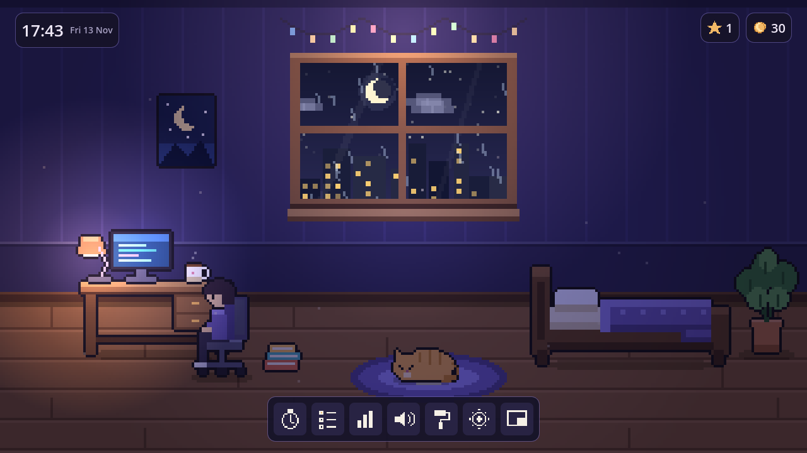
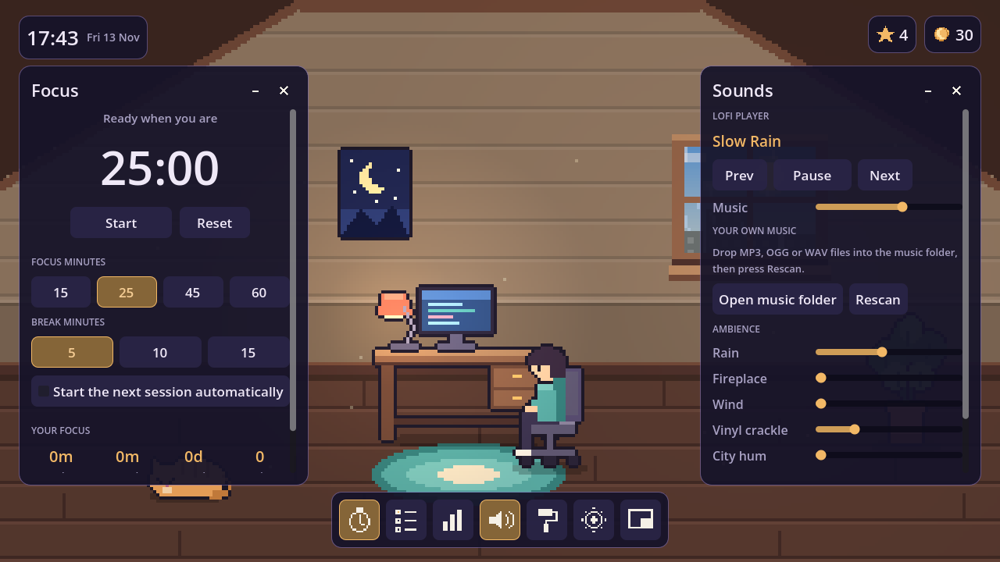

# Midnighty Room

A cozy late-night room that sits on your desktop while you work. Decorate it, mix your own lofi soundscape, run a focus timer, tick off tasks, and level up to unlock furniture and new rooms.

Built with Godot 4.7 (GDScript, Compatibility renderer). Target: Steam on Windows first; the same project exports to Linux, macOS, Android and iOS.





## Run it

1. Install [Godot 4.7.x](https://godotengine.org/download) (standard build, not .NET).
2. Open Godot, choose **Import**, and pick `project.godot` in this folder.
3. Press **F5**.

Ready-made Windows builds live in `build/` if you were given the project folder rather than a fresh clone (builds are not stored in git).

## What is in the game

| Feature | Notes |
|---|---|
| Rooms | Three rooms with their own windows and wall treatments: Bedroom, Attic studio (level 3), City loft (level 6). Each keeps its own layout, colours and two saved layout slots. |
| Items | 83 placeable items in 8 themed sets, 10 of them recolourable, many animated or glowing. |
| Decorate mode | Drag to move, arrow keys to nudge, **F** to flip, **Delete** to remove. Small things snap onto desks, shelves and the window sill, and move with the furniture they sit on. |
| Panels | Every panel can be dragged by its title, collapsed (the minus button or a double-click on the title), and fades out of the way while you drag an item. |
| A living room | Your character types while you focus, sips cocoa on breaks and dozes in the small hours. Miso the cat naps, wanders and sits. Plants sway, screens flicker, fires and candles dance. |
| Day and night | Follows your system clock by default. Sun, moon, stars, clouds, a skyline with lit windows. Lamps glow as it gets dark. |
| Sound mixer | 3 lofi loops and 7 ambience layers. Drop your own MP3, OGG or WAV files into the music folder (Sounds > Open music folder) and they join the playlist. |
| Focus timer | 15/25/45/60 minute blocks with breaks, optional auto-loop. Runs off the system clock, so it stays accurate when minimised. |
| Progression | Moonlight (currency) from focus and tasks. XP levels up to 20; each level pays moonlight and unlocks items or a room. Three daily goals. Focus calendar and lifetime stats. |
| Companion modes | Mini room, tiny room, or a timer-only pill on a see-through window. Always on top, draggable, remembers its position. System tray icon with a menu. Taskbar flash when a timer ends. |
| Settings | Separate volumes, time of day, interface size, language, rebindable keys, battery saver. |
| First run | A five-card guide. |
| Languages | English and Bahasa Melayu. All text goes through `locale/strings.csv`. |
| Saves | JSON at `user://save.json`, written atomically. Saves from v0.1 are migrated. |

Default keys (all rebindable): **Space** timer, **M** music, **D** decorate, **F10** mini window, **F11** fullscreen, **F12** screenshot, **Esc** close.

## Project layout

```
project.godot
scenes/main.tscn            one node; everything else is built in code
scripts/
  main.gd                   viewport, HUD, panels, input, window modes, tray
  selftest.gd               80 logic checks
  autoload/
    game_state.gd           save data, moonlight, levels, goals, rooms, keys
    focus_timer.gd          pomodoro clock
    audio_mixer.gd          buses, ambience, playlist (built-in + your files)
    steam_service.gd        optional Steam hooks (no-op without GodotSteam)
  data/catalog.gd           every item, room, wall and floor: edit this to add content
  room/room.gd              walls, floor, time of day, drag and drop, surfaces
  room/furniture_item.gd    one placed item and its behaviour (cat, avatar, lamps)
  room/sky.gd               the view through the window
  ui/                       theme helpers, panels, onboarding
assets/sprites, icons, audio
locale/strings.csv          all interface text and translations
tools/gen_art.py            regenerates every sprite
tools/gen_audio.py          regenerates every sound
tools/extract_strings.py    refreshes locale/strings.csv from the scripts
docs/                       market notes and the Steam release checklist
```

## Adding content

**An item:** save a PNG to `assets/sprites/my_item.png` and add one line to `ITEMS` in `scripts/data/catalog.gd`:

```gdscript
"my_item": {"name": "My item", "layer": "floor", "price": 20, "level": 2, "set": "Lounge"},
```

Optional keys: `kind`, `light`, `frames` + `fps`, `variants`, `surface`. They are documented at the top of the file.

**A room:** add an entry to `ROOMS` with a window sprite, its position, the see-through `pane` rectangle, a wall `style` and a starter layout.

**A language:** add a column to `locale/strings.csv` named with the locale code, fill it in, reopen the project so Godot re-imports it, and add the new `.translation` file under Project Settings > Localization. For Chinese, Japanese or Korean you also need a font with those glyphs set as the theme font.

After changing interface text run `python3 tools/extract_strings.py`.

## Replacing the art and audio

All sprites and sounds were generated by the scripts in `tools/`, so there is nothing to license. Any file can be swapped for hand-made art or recorded audio with the same file name; no code changes needed. This is the single biggest lever on how well the game sells (see `docs/MARKET_NOTES.md`).

To regenerate: `pip install pillow numpy scipy`, install ffmpeg, then `python3 tools/gen_art.py` and `python3 tools/gen_audio.py`.

## Testing

```
godot --headless --path . -- --selftest
```

Runs 80 checks against a throwaway save file and exits non-zero on failure. It covers the catalogue, buying and level locks, placing, drag bounds, surface snapping, recolouring, hover, save/load, migration from v0.1, tasks, the timer, levels, rooms, layout slots, daily goals, key bindings, the user music folder, languages, time of day and reset.

Developer flags, after `--`: `--fresh`, `--hour=23.5`, `--room=1`, `--xp=500`, `--locale=ms`, `--panel=focus,decorate`, `--onboarding`, `--shot=out.png`.

## Building

Install export templates once (Editor > Manage Export Templates), then:

```
godot --headless --path . --export-release "Windows Desktop"
godot --headless --path . --export-release "Windows Demo"
godot --headless --path . --export-release "Linux"
```

Output goes to `build/`. Windows builds are single files with the icon and version info embedded. The demo preset sets the `demo` feature tag, which limits the game to the first room and to items of level 2 or below costing 40 moonlight or less.

## Status and known gaps

Working and tested here: everything in the table, through the self-test on the project and on an exported Linux build, plus reviewed screenshots of each room and panel.

Could not be verified in the build environment and needs a check on a real Windows desktop:

- The mini window styles, especially the see-through timer widget and its click-through area.
- The system tray icon and menu.
- The taskbar flash when a timer ends.
- How the synthesized audio actually sounds.

Not done:

- Steam: the hooks are written, but GodotSteam is not bundled (it could not be downloaded here) and no App ID is set, so achievements and cloud saves are untested. See `docs/STEAM_RELEASE.md`.
- Chinese, Japanese and Korean translations. The Malay translation is machine-written and wants a native read-through.
- Controller and Steam Deck layout.

## Roadmap suggestions

1. Commission or buy a cohesive art pass and 10 to 20 real lofi tracks.
2. Steam page with the demo as early as possible; wishlists build slowly.
3. Translate into Simplified Chinese, Japanese and Korean.
4. Seasonal items and rooms as free updates, then cosmetic DLC.
5. Android and iOS exports once the PC version is selling.
